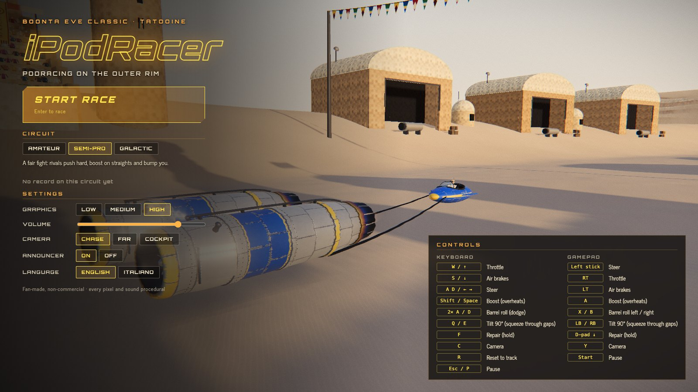
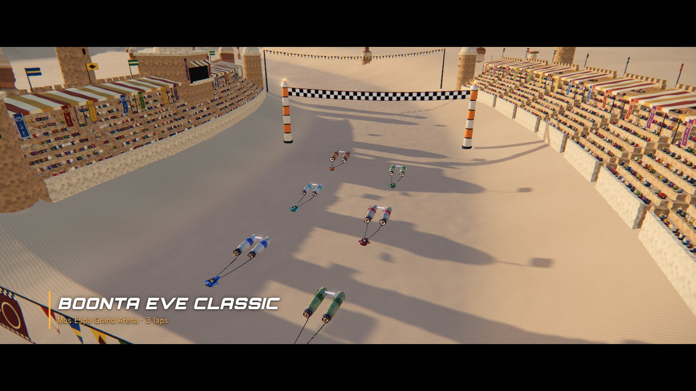
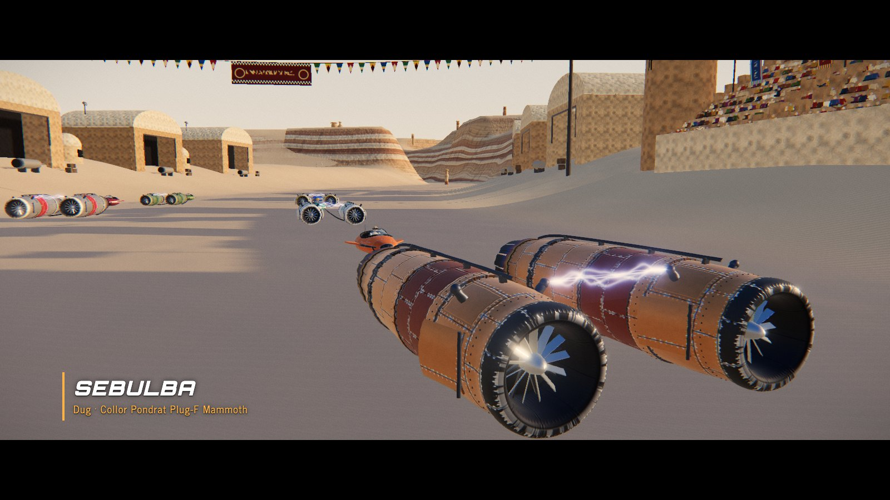
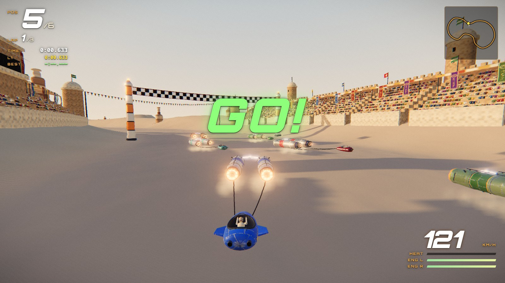
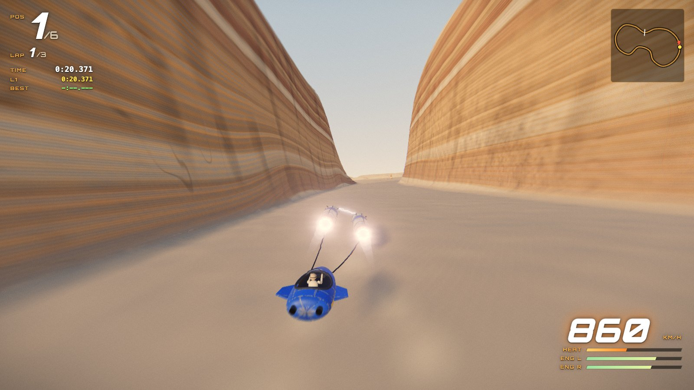
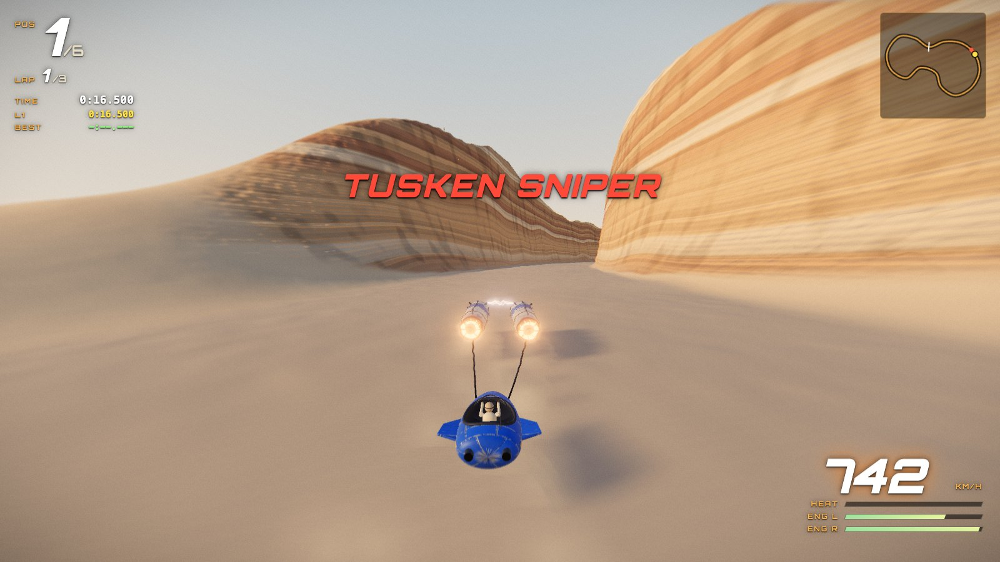
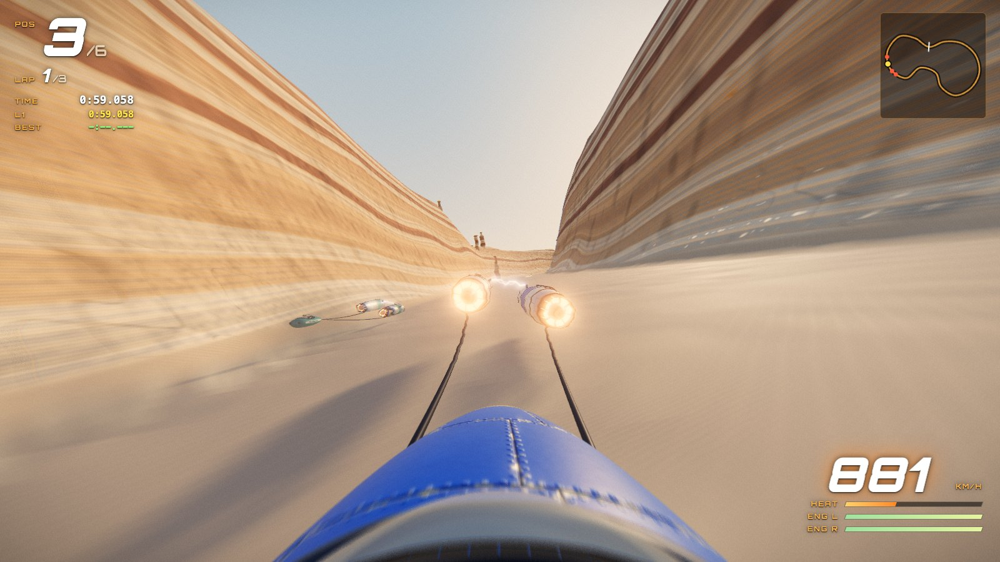
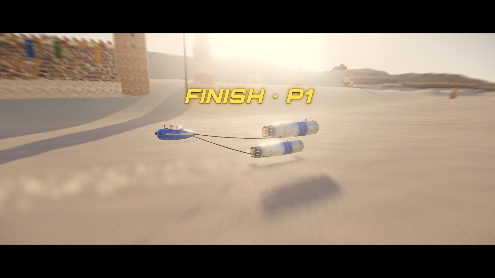

# iPodRacer

> [!IMPORTANT]
> **Unofficial, free, non-commercial fan game.** Not affiliated with, endorsed, sponsored or approved by Lucasfilm Ltd. or The Walt Disney Company. *Star Wars* and all related names, characters and vehicles are trademarks and/or copyrights of Lucasfilm Ltd. / Disney, used here only for non-commercial fan purposes. Nothing here is for sale, ever. The code licence covers only our original source code and grants no rights in any Lucasfilm/Disney property.
> **Read [LEGAL.md](LEGAL.md) before copying, forking or distributing.**



> [!NOTE]
> **AI-assisted.** This project was built with heavy help from AI coding assistants. It is purely a personal exercise in style, sister project of [The Battle of Yavin](https://github.com/tcsenpai/yavin). It is not a product, not a portfolio piece and not a commercial undertaking.

A 3D podracing game for the browser and the desktop (Windows, macOS, Linux) in the spirit of the Boonta Eve Classic from *Star Wars: Episode I – The Phantom Menace* (1999): fly Anakin's pod for three laps around Mos Espa, through sandstone canyons and under natural arches, against Sebulba and four other rivals. Built with Vite, TypeScript and three.js.

**Everything is procedural.** Terrain, rock, sand, pods, crowd, buildings, creatures, textures, shaders, sound effects, music and even the app icon are generated by code at runtime or build time. The repository contains no images, audio, 3D models or logos from the films or any third party (the screenshots below are captured from the game itself). The only bundled third-party assets are two open-source fonts under the SIL Open Font License: Orbitron (titles and HUD) and News Cycle (body text), installed via `@fontsource`.

## Download

Desktop builds for **Windows** (installer or portable), **macOS** (Apple Silicon and Intel, `.dmg`) and **Linux** (`.AppImage` or `.deb`) are attached to each [GitHub release](https://github.com/tcsenpai/iPodRacer/releases). The builds are not code-signed: on macOS right-click the app and choose *Open* the first time (or run `xattr -dr com.apple.quarantine "/Applications/iPodRacer.app"`); on Windows choose *More info → Run anyway* in SmartScreen. F11 or Alt+Enter toggles fullscreen.

## Screenshots

All captured in-engine (real-time, procedural assets).















## Features

- **The Boonta Eve Classic**: a 15 km course over the dune sea, two sandstone canyons, natural arches, hoodoo slaloms and rock spires standing on the racing line. Three laps, six pods.
- **Three circuits of difficulty**: **Amateur**, **Semi-Pro** and **Galactic**. Rival pace, cornering, boost use, ramming, sniper accuracy and the damage you take all scale with it. Best result saved per circuit.
- **Five rivals with personalities**: Sebulba (fast, rams you, vents flame into anyone alongside), Gasgano, Mawhonic, Ody Mandrell and Aldar Beedo. Rivals avoid the spires, brake for corners, boost on straights, show off with barrel rolls and can crash out of the race.
- **Podracer handling**: about 775 km/h flat out and over 1000 km/h with the boost, which overheats the engines. Air brakes tighten the turn, the pod slides on loose sand and takes off from dune crests.
- **Maneuvers**: double-tap to **barrel roll** (a sidestep that shoulders rivals aside), hold to **knife edge** (tilt 90 degrees to slip past rocks). Near misses cool the engines, so flying close to the rocks pays off. A **perfect start** rewards hitting the throttle as the lights go.
- **Per-engine damage and repair** in the spirit of *Episode I: Racer*: each engine wears separately, a hurt engine pulls the pod to its side, smokes, misfires and scorches, and holding repair patches it at the cost of speed.
- **Film hazards**: Tusken Raiders on the canyon rims telegraph each shot with a scope glint (roll or knife edge to make them miss), and Sebulba's flame vent.
- **Cinematic presentation**: intro with rival introductions, countdown, slow motion on crashes, knife-edge near misses and the finish, camera shake, speed zoom blur and heat shimmer, race commentary through the browser's speech synthesis.
- **A living Mos Espa**: grandstands with thousands of animated fans who cheer as pods pass, banners and pennants in the wind, hangars, moisture vaporators, a Jawa sandcrawler, Tusken camps and bantha herds that scatter from passing pods.
- **Procedural audio**: synthesized snarling pod engines with doppler flybys, wind, impacts, explosions, crowd roar, and an original procedural score.
- Keyboard and gamepad support; chase, far chase and cockpit cameras; three quality profiles.
- Bilingual **English / Italian**, with an i18n layer ready for more languages.

## Difficulty

| Circuit | Description |
|---|---|
| Amateur | Forgiving: slower rivals that never ram you, half damage, inaccurate snipers. |
| Semi-Pro | The intended experience: rivals push hard, boost on straights and bump you. |
| Galactic | Ruthless: rivals at your pace, Sebulba hunts you, every hit hurts. |

## Controls

| Keyboard | Gamepad | Action |
|---|---|---|
| W / Up | RT | Throttle |
| S / Down | LT | Air brakes (slow down, tighter turn) |
| A D / Left Right | Left stick | Steer |
| Shift / Space | A | Boost (builds engine heat; near misses cool it) |
| Double-tap A or D | X / B | Barrel roll: sidestep, shoulders rivals aside, dodges sniper shots |
| Q / E | LB / RB | Knife edge: tilt 90 degrees to slip past rocks and dodge shots |
| F (hold) | D-pad down | Repair the worse engine (throttle capped, no boost) |
| C | Y | Camera (chase, far, cockpit) |
| R | View | Back to the track |
| Enter | A | Skip the intro |
| Esc / P | Start | Pause |

## Run and build

Requires Node.js 22+ with npm (or [Bun](https://bun.sh)).

```bash
npm install
npm run dev        # development server on http://localhost:5175/
npm run build      # tsc --noEmit + vite build → dist/
npm run preview    # serve the production build
npm run app        # build and run as a desktop app (Electron)
npm run dist       # procedural icon + build + desktop installers for the current OS → release/
```

Desktop releases are built by GitHub Actions (`.github/workflows/release.yml`) on Windows, macOS and Linux when a `v*` tag is pushed, and attached to the GitHub release. Every push and pull request is type-checked and built by `.github/workflows/ci.yml`. The app icon is procedural as well: `scripts/make-icon.mjs` renders it in software at build time.

## How it works

- **Rendering**: three.js with a logarithmic depth buffer, an MSAA HDR pass, bloom, ACES tone mapping, an anamorphic sun flare and a film finish pass (grade, grain, vignette, zoom blur, heat shimmer).
- **World**: a closed Catmull-Rom course with a spatial-hash nearest-point query; the terrain height function carves the track bed and canyons into dunes and mesas, meshed as a dense corridor along the track plus a coarse 14 km backdrop. Rock and sand are shaded by one patched standard material: sandstone strata, joint cracks, wind ripples and sun glints computed per pixel from world-space noise.
- **Pods**: lathe and extruded geometry with 1024 px PBR maps (paint masks, normals, roughness and metalness) painted in code; liveries are applied in the shader so all pods share geometry and textures.
- **Physics and AI**: an arcade model with thrust and drag, yaw-rate steering, lateral slip, a sprung hover with airtime, circle colliders and per-engine wear. Rival pilots chase a racing line, choose lanes that clear every rock ahead, brake by the curvature ahead and use the same controls as the player.
- **Audio**: Web Audio synthesis for engines, effects and music (`src/audio`); commentary via the browser's speech synthesis.
- **Determinism**: a seeded RNG (`src/core/rng.ts`) keeps generated content stable between runs.

## Project structure

```
electron/ desktop shell (Electron main process)
scripts/  build helpers (procedural app icon generator)
src/
  core/    renderer and post chain, input (keyboard/gamepad), settings, seeded RNG
  render/  MSAA pass, sun flare probe, finish shader
  game/    pods and physics, AI pilots, race flow, cameras, hazards, particle effects
  models/  procedural podracer model and textures
  world/   track, terrain, surface shaders, sky, props, crowd and desert life, dust
  audio/   procedural sound effects, music and race commentary
  ui/      HUD and menus
  i18n/    dictionaries (en.ts, it.ts) and translation helpers (i18n.ts)
  main.ts  entry point
```

See [AGENTS.md](AGENTS.md) for the detailed architecture, conventions and how changes are verified.

## Adding a language

1. Copy `src/i18n/it.ts` to e.g. `src/i18n/fr.ts`, rename the export, and translate every value. The object must be typed as `Dictionary`: TypeScript enforces the exact key set defined by `src/i18n/en.ts`, so a missing or misspelled key fails the build.
2. Register it in `LANGS` in `src/i18n/i18n.ts`:
   ```ts
   { id: 'fr', label: 'Français', speech: 'fr-FR', dict: fr },
   ```
   `speech` is the BCP 47 tag used for the race commentary.
3. Run `npm run build` to type-check.

## Credits and legal

- Created by the iPodRacer contributors as a non-commercial tribute.
- Inspired by *Star Wars: Episode I – The Phantom Menace* (1999), written and directed by George Lucas, and by the game *Star Wars Episode I: Racer* (1999). *Star Wars* © & ™ Lucasfilm Ltd. All rights reserved by their owners. All commentary and on-screen text are original writing.
- Built with [three.js](https://threejs.org) (MIT), [Vite](https://vite.dev) (MIT), [TypeScript](https://www.typescriptlang.org) (Apache-2.0) and [Electron](https://www.electronjs.org) (MIT). Fonts: [Orbitron](https://github.com/theleagueof/orbitron) and [News Cycle](https://github.com/googlefonts/NewsCycle) (SIL Open Font License 1.1).
- Source code: [PolyForm Noncommercial 1.0.0](LICENSE): **non-commercial use only**, and it does not license any Lucasfilm/Disney property. See [LEGAL.md](LEGAL.md) for the full notice, the no-monetisation rules and the rights-holder takedown policy.
